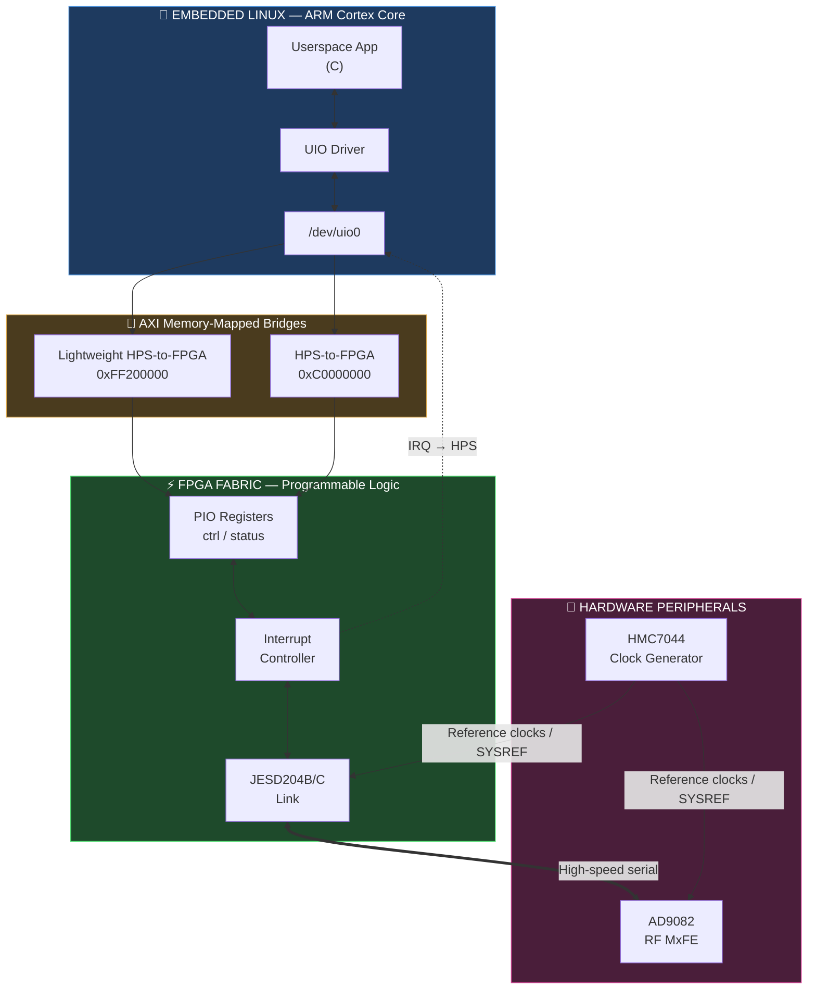
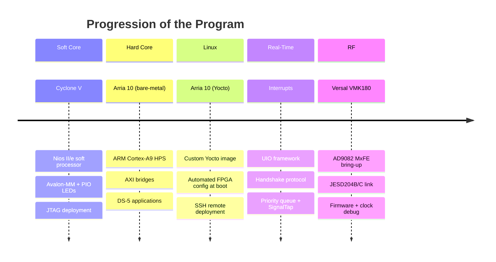
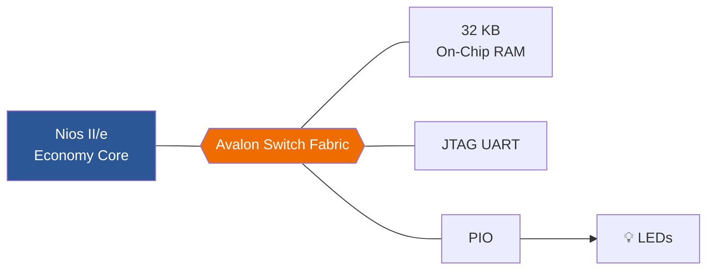
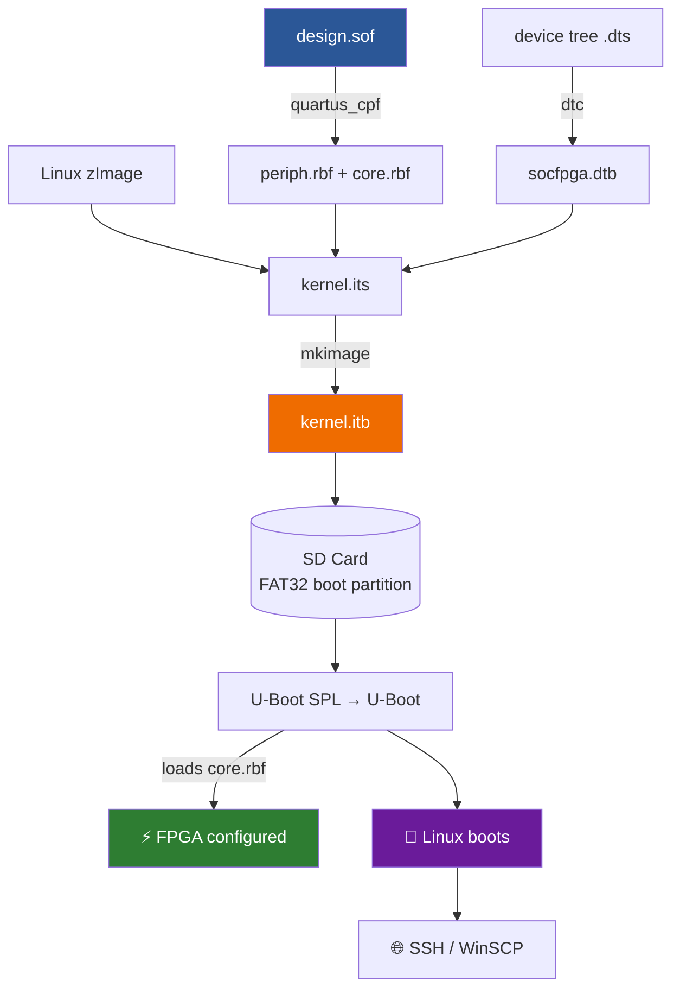
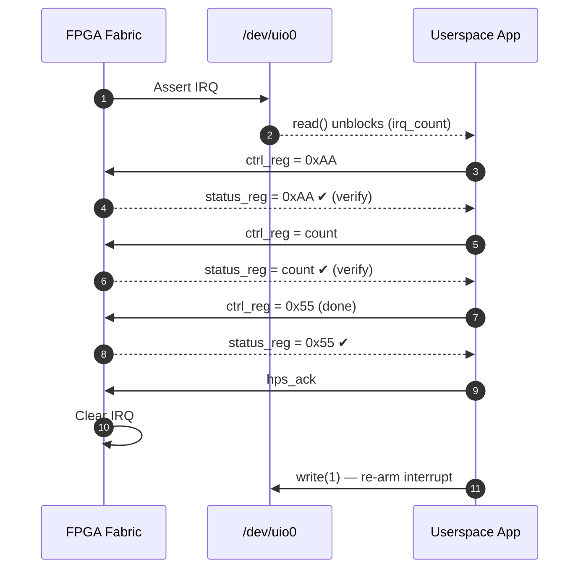
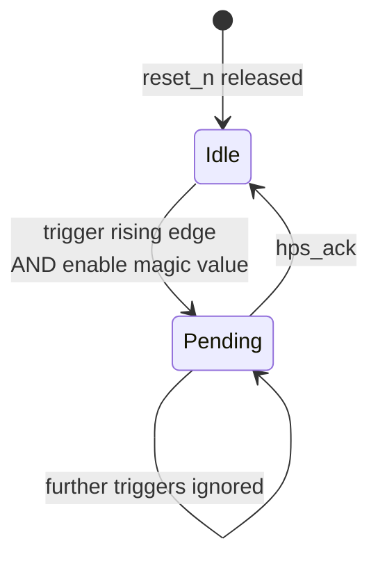
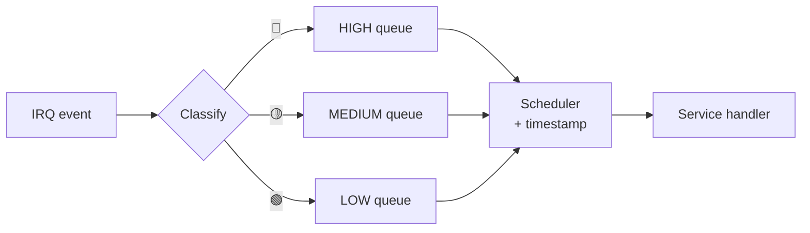
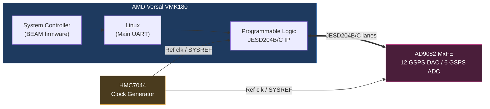

<div align="center">

# 🚀 FPGA-SoC & Embedded Linux Development Portfolio

### From VHDL in the fabric → Yocto Linux on ARM → 12 GSPS RF links


[Overview](#-overview) •
[Architecture](#-system-architecture) •
[Modules](#-project-modules) •
[Code](#-key-code-snippets) •
[Getting Started](#-getting-started) •
[Achievements](#-key-achievements) •
[Author](#-author)

</div>

---

## 📑 Table of Contents

1. [Overview](#-overview)
2. [System Architecture](#-system-architecture)
3. [Learning Journey](#-learning-journey)
4. [Tech Stack](#-tech-stack--tools)
5. [Project Modules](#-project-modules)
6. [Key Code Snippets](#-key-code-snippets)
7. [Getting Started](#-getting-started)
8. [Repository Structure](#-repository-structure)
9. [Key Achievements](#-key-achievements)
10. [Troubleshooting](#-troubleshooting--lessons-learned)
11. [Author](#-author)

---

## 📖 Overview

This repository contains the **hardware designs, kernel-space/userspace software, and build scripts** developed during an intensive FPGA-SoC and Embedded Linux engineering program.

The work covers the **complete hardware-software co-design stack**:

| Layer | What was built |
|-------|----------------|
| 🧩 **FPGA fabric** | VHDL / SystemVerilog logic, PIO registers, interrupt controller |
| 🔌 **Interconnect** | Avalon-MM (Intel) and AXI4 (HPS ↔ FPGA bridges) |
| 🧠 **Processors** | Nios II soft core → ARM Cortex-A9 HPS → AMD Versal Linux |
| 🐧 **Operating system** | Custom Yocto Linux, U-Boot, device tree, UIO |
| 📡 **High-speed RF** | AD9082 MxFE over JESD204B/C with HMC7044 clocking |

**Platforms explored:** Intel Cyclone V · Intel Arria 10 SoC · AMD Versal VMK180

---

## 🏗️ System Architecture

The core of this portfolio is bridging the **Hard Processor System (HPS)** with the **Programmable Logic (FPGA fabric)** using memory-mapped I/O and interrupt-driven communication.

### High-Level Block Diagram



<details>
<summary>📋 ASCII version (for terminals / plain-text viewers)</summary>

```text
+-----------------------------------------------------------------------+
|                        EMBEDDED LINUX (ARM CORE)                      |
|  [ Userspace App ] <--> [ UIO Driver ] <--> [ /dev/uio0 ]             |
+-----------------------------------------------------------------------+
          | AXI Memory-Mapped Bus (0xC0000000 / 0xFF200000)
          v
+-----------------------------------------------------------------------+
|                        FPGA FABRIC (PROGRAMMABLE LOGIC)               |
|  [ PIO Registers ] <--> [ Interrupt Controller ] <--> [ JESD204 Link ]|
+-----------------------------------------------------------------------+
          | Hardware Interrupts / High-Speed Serial
          v
+-----------------------------------------------------------------------+
|                    HARDWARE PERIPHERALS (AD9082 / HMC7044)            |
+-----------------------------------------------------------------------+
```

</details>

### End-to-End Development Workflow

```mermaid
flowchart LR
    A["✍️ Write HDL<br/>VHDL / SystemVerilog"] --> B["🧱 Platform Designer<br/>Qsys system"]
    B --> C["⚙️ Quartus / Vivado<br/>Compile"]
    C --> D[".sof / .bit<br/>bitstream"]
    D --> E["🔄 Convert<br/>.sof → .rbf"]
    E --> F["📦 Package<br/>.itb via mkimage"]
    F --> G["💾 SD Card<br/>FAT32 + rootfs"]
    G --> H["🚀 Boot Linux<br/>U-Boot → Kernel"]
    H --> I["🌐 SSH / WinSCP<br/>deploy apps"]
    I --> J["🔍 SignalTap<br/>validate"]
    J -. "iterate" .-> A

    style A fill:#2b5797,color:#fff
    style D fill:#2e7d32,color:#fff
    style G fill:#ef6c00,color:#fff
    style J fill:#c62828,color:#fff
```



---

## 🗺️ Learning Journey



---

## 🛠️ Tech Stack & Tools

| Category | Technologies & Tools |
|----------|----------------------|
| 🧩 **Hardware Design** | VHDL, SystemVerilog, Quartus Prime, Platform Designer (Qsys), Vivado |
| 💻 **Software Dev** | Embedded C, ARM DS-5, Eclipse (Nios II SBT), Make, Git |
| 🐧 **Operating Systems** | Yocto Project (Poky), U-Boot, Linux Kernel, Ubuntu (build host) |
| 🔌 **Interfaces & Buses** | AXI4, Avalon-MM, UIO, JESD204B/C, SPI, I2C, UART, PCIe |
| 🔍 **Debug & Validation** | SignalTap Logic Analyzer, JTAG, USB-Blaster, PuTTY, WinSCP, SSH |
| 📁 **File Formats** | `.sof`, `.rbf` (Periph/Core), `.dtb` (Device Tree), `.itb` (Boot Image) |

---

## 📂 Project Modules

### Module Summary

| # | Module | Platform | Processor | Key Skill |
|---|--------|----------|-----------|-----------|
| 1 | Soft Processor System | Cyclone V | Nios II/e (soft) | Avalon-MM, memory-mapped I/O |
| 2 | HPS & AXI Bridge Integration | Arria 10 | ARM Cortex-A9 | AXI bridges, `mmap()` |
| 3 | Embedded Linux & Yocto | Arria 10 | ARM Cortex-A9 | Boot flow, device tree, remote deploy |
| 4 | Interrupt-Driven Interface | Arria 10 | ARM Cortex-A9 | UIO, handshake, priority queue |
| 5 | Versal + AD9082 RF | Versal VMK180 | Cortex-A72 (Linux) | JESD204B/C, clocking, firmware |

---

### 1️⃣ Soft Processor System (Intel Cyclone V)

Built a custom **32-bit Nios II soft processor** entirely inside the FPGA fabric using Platform Designer.



- **Components:** Nios II/e, 32 KB on-chip memory, JTAG UART, PIO for LEDs
- **Workflow:** C applications in Eclipse Nios II SBT (binary counter, right-shift patterns); `.elf` deployed over JTAG
- **Key learning:** Memory-mapped I/O with `IOWR()` macros and the Avalon switch fabric

---

### 2️⃣ HPS & AXI Bridge Integration (Intel Arria 10)

Moved from a soft processor to the physical **ARM Cortex-A9 Hard Processor System (HPS)**.

| Bridge | Base Address | Typical Use |
|--------|--------------|-------------|
| Lightweight HPS-to-FPGA | `0xFF200000` | Control/status registers |
| HPS-to-FPGA | `0xC0000000` | Wider, higher-throughput access |

- **Workflow:** Configured both bridges and controlled FPGA LEDs from the ARM core
- **Implementation:** ARM DS-5 applications that map the AXI bus into the process address space (`mmap()` on `/dev/mem` when running under Linux)
- **Key learning:** Direct hardware control of fabric peripherals from the HPS

---

### 3️⃣ Embedded Linux & Yocto Builds (Intel Arria 10)

Transitioned from bare-metal to a **full Linux environment**.



- **Distribution:** Custom Linux built with the Yocto Project on an Ubuntu VM
- **Boot flow:** Automated FPGA configuration at boot by converting `.sof` → `.rbf` (Peripheral + Core), compiling the device tree (`.dtb`), and packaging everything into a `.itb` (Image Tree Blob) with `mkimage`
- **Remote deployment:** PuTTY (UART/SSH) and WinSCP to transfer files and execute code over Ethernet

---

### 4️⃣ Interrupt-Driven Hardware/Software Interfaces

A real-time interrupt handling system built on the Linux **UIO (Userspace I/O)** framework.

#### Handshake Protocol (`pio_ctrl_reg` ↔ `pio_status_reg`)



#### Interrupt Controller State Machine



#### Priority Queue



- **Handshake:** Write-verify protocol (`0xAA` → count → `0x55`) to guarantee data integrity
- **Priority queue:** C-based HIGH / MEDIUM / LOW queue managing asynchronous interrupts with real-time timestamps
- **Validation:** Register writes captured and verified in real time with **SignalTap Logic Analyzer**

---

### 5️⃣ AMD Versal VMK180 + AD9082 RF MxFE Integration

Evaluated a high-end Adaptive SoC platform for high-speed RF data communication.



- **Board bring-up:** Multi-UART terminals (COM32–34) for Versal Main Linux and the System Controller
- **JESD204B/C initialization:** Brought up the high-speed serial link between the AD9082 (12 GSPS DAC / 6 GSPS ADC) and the Versal FPGA
- **Firmware validation:** Debugged boot hangs and fault LEDs (`HMC_STATUS`, `IRQB0`) by updating System Controller (BEAM) firmware and verifying clock synchronization through the HMC7044

---

## 💻 Key Code Snippets

### UIO Interrupt Handler (Embedded C)

```c
#include <stdint.h>
#include <fcntl.h>
#include <unistd.h>
#include <sys/mman.h>

#define CTRL_OFFSET    0   /* word index of pio_ctrl_reg   */
#define STATUS_OFFSET  1   /* word index of pio_status_reg */

int main(void)
{
    uint32_t irq_count = 0;
    uint32_t reenable  = 1;

    int fd = open("/dev/uio0", O_RDWR);
    volatile uint32_t *fpga_regs = mmap(NULL, 0x1000, PROT_READ | PROT_WRITE,
                                        MAP_SHARED, fd, 0);

    while (1) {
        /* Block until the hardware interrupt fires */
        read(fd, &irq_count, sizeof(irq_count));

        /* Hardware handshake: write and verify */
        fpga_regs[CTRL_OFFSET] = 0xAA;
        while (fpga_regs[STATUS_OFFSET] != 0xAA);

        fpga_regs[CTRL_OFFSET] = irq_count & 0xFF;
        while (fpga_regs[STATUS_OFFSET] != (irq_count & 0xFF));

        fpga_regs[CTRL_OFFSET] = 0x55;
        while (fpga_regs[STATUS_OFFSET] != 0x55);

        /* Re-arm (unmask) the interrupt in the UIO kernel driver */
        write(fd, &reenable, sizeof(reenable));
    }
}
```

### SystemVerilog Interrupt Controller

```systemverilog
always @(posedge clk or negedge reset_n) begin
    if (!reset_n) begin
        Trigger_OUT_Interupt <= 1'b0;
        interrupt_pending    <= 1'b0;
    end else begin
        if (ctrl_reg == 32'h00001F1F) begin          // Enable magic value
            if (Trigger_Interupt_rise && !interrupt_pending) begin
                interrupt_pending    <= 1'b1;
                Trigger_OUT_Interupt <= 1'b1;        // Assert IRQ to HPS
            end
            if (hps_ack && interrupt_pending) begin
                interrupt_pending    <= 1'b0;
                Trigger_OUT_Interupt <= 1'b0;        // Clear IRQ
            end
        end
    end
end
```

### Nios II LED Counter (C)

```c
#include "system.h"
#include "io.h"
#include "unistd.h"

int main(void)
{
    unsigned char count = 0;
    while (1) {
        IOWR(PIO_LED_BASE, 0, count++);   // Write to PIO via Avalon
        usleep(200000);
    }
    return 0;
}
```

---

## 🚀 Getting Started

> **Note:** This is a high-level summary. Detailed build logs are available in the [`/docs`](./docs) folder.

### Prerequisites

| Requirement | Details |
|-------------|---------|
| Host OS | Ubuntu 22.04 / 24.04 (VM is fine) for Yocto; Windows or Linux for Quartus/Vivado |
| FPGA tools | Quartus Prime (Intel boards), Vivado (AMD boards) |
| Hardware | Target board, USB-Blaster (JTAG), UART/USB cables, SD card |
| Disk / RAM | ≥ 100 GB free disk, ≥ 16 GB RAM recommended for Yocto |

### Step-by-Step

<details open>
<summary><b>Step 1 — Hardware setup</b></summary>

Connect the USB-Blaster (JTAG) and UART cables to the Intel/AMD board, then open a serial terminal (PuTTY) at **115200 8N1**.

</details>

<details open>
<summary><b>Step 2 — FPGA compilation</b></summary>

Open Quartus / Vivado, compile the HDL, and generate the `.sof` / `.bit` file. Convert for Linux boot (Intel):

```bash
quartus_cpf -c design.sof design.rbf
```

</details>

<details open>
<summary><b>Step 3 — Yocto build (host PC)</b></summary>

```bash
git clone -b scarthgap git://git.yoctoproject.org/poky
git clone -b scarthgap https://github.com/altera-opensource/meta-intel-fpga.git
source poky/oe-init-build-env
bitbake core-image-minimal
```

</details>

<details open>
<summary><b>Step 4 — Flash the SD card</b></summary>

Write the generated `.wic` image with `dd` (Linux) or Win32DiskImager (Windows). Copy the generated `.itb` and `.dtb` files to the FAT32 boot partition.

```bash
sudo dd if=core-image-minimal-<machine>.wic of=/dev/sdX bs=4M status=progress conv=fsync
```

> ⚠️ Double-check `/dev/sdX` — `dd` will overwrite whatever device you point it at.

</details>

<details open>
<summary><b>Step 5 — Remote execution</b></summary>

Boot the board, connect via SSH, transfer your compiled binary with WinSCP/`scp`, and run it:

```bash
scp my_app root@<board-ip>:/home/root/
ssh root@<board-ip> "chmod +x my_app && ./my_app"
```

</details>

---

## 🗂️ Repository Structure

> Adjust folder names to match your repository.

```text
.
├── 01_cyclone_v_nios2/        # Nios II system + LED C apps
│   ├── hw/                    #   Platform Designer / Quartus project
│   └── sw/                    #   Eclipse Nios II SBT sources
├── 02_arria10_hps_baremetal/  # DS-5 projects, AXI bridge tests
├── 03_arria10_yocto/          # Yocto layers, .its, boot scripts
├── 04_uio_interrupts/
│   ├── rtl/                   #   SystemVerilog interrupt controller
│   ├── app/                   #   UIO userspace app + priority queue
│   └── signaltap/             #   .stp captures
├── 05_versal_ad9082/          # Vivado project, bring-up notes
├── docs/                      # Detailed build logs & screenshots
└── README.md
```

---

## 🏆 Key Achievements

| 🎯 Achievement | Detail |
|----------------|--------|
| ⚙️ **Automated boot configuration** | FPGA configured automatically during the Linux boot cycle on Arria 10 SoC |
| ⏱️ **Faster iteration** | Shifted from JTAG-based debugging to SSH/Ethernet remote deployment, cutting deployment iteration time (~80 %) |
| 📡 **RF link bring-up** | Resolved JESD204B clock-synchronization faults on Versal VMK180 via boot-log analysis and System Controller firmware update |
| 🔬 **Cycle-accurate validation** | Verified hardware-software handshakes at clock-cycle resolution using SignalTap |

---

## 🧯 Troubleshooting & Lessons Learned

| Symptom | Likely Cause | Fix |
|---------|--------------|-----|
| `/dev/uio0` missing | UIO node not in device tree / driver not loaded | Add `compatible = "generic-uio"` node (or `uio_pdrv_genirq`) and rebuild `.dtb` |
| FPGA not configured at boot | Wrong `.rbf` type or path in `.itb` / U-Boot script | Regenerate periph + core `.rbf`, re-run `mkimage` |
| Bus hang on first register access | Bridge not enabled / reset not released | Enable bridges in U-Boot / device tree |
| `HMC_STATUS` / `IRQB0` LED fault on VMK180 | Outdated System Controller firmware, clock not locked | Update BEAM firmware, verify HMC7044 lock |
| Interrupt fires only once | UIO interrupt not re-armed | `write(fd, &1, 4)` after handling |

---

## 👨‍💻 Author

<div align="center">

**Shashank**
B.Tech — Electronics and Communication Engineering
Birla Institute of Technology, Mesra

[](https://www.linkedin.com/in/shashank-12-/)
[](https://github.com/shashank-1-2)

</div>

---

<sub>**Disclaimer:** Specific register addresses and proprietary board files have been sanitized for public distribution.</sub>
